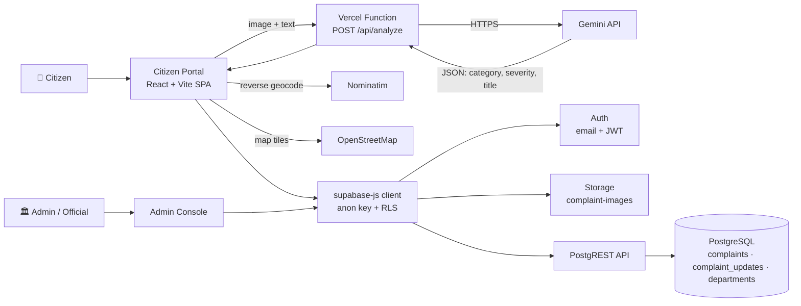

<div align="center">

# 🏙️ CivicPulse AI

### AI-powered Civic Complaint Intelligence & Monitoring Platform

*Smarter civic systems. Stronger communities.*


[**Live Demo**](#) · [**Report a Bug**](https://github.com/bulbulali22-cell/civicpulse-ai/issues) · [**Request a Feature**](https://github.com/bulbulali22-cell/civicpulse-ai/issues)

</div>

---

## 📑 Table of Contents

- [About the Project](#-about-the-project)
- [The Problem](#-the-problem)
- [Our Solution](#-our-solution)
- [Key Features](#-key-features)
- [Screenshots](#-screenshots)
- [System Architecture](#-system-architecture)
- [Tech Stack](#-tech-stack)
- [Getting Started](#-getting-started)
- [Environment Variables](#-environment-variables)
- [Project Structure](#-project-structure)
- [How the AI Analysis Works](#-how-the-ai-analysis-works)
- [Roadmap](#-roadmap)
- [Market Positioning](#-market-positioning)
- [Sustainable Development Goals](#-sustainable-development-goals)
- [Team](#-team)
- [Contributing](#-contributing)
- [License](#-license)

---

## 📖 About the Project

**CivicPulse AI** connects citizens with local authorities to report, track, and resolve civic issues efficiently. A citizen snaps a photo of a problem (a pothole, overflowing garbage, a broken streetlight), the app captures the GPS location, and **Google Gemini** analyses the image to automatically identify the issue category, assign a **severity score (1-10)**, and generate a title and description.

Every complaint lands in a live dashboard where officials can see issues on a **map with geographic hotspots**, prioritise by severity, assign them, and update their status, while citizens can track progress with a simple reference ID.

> Built for **Hack4Tech 2026** by **Team God's Favourite**, with Mathura, Uttar Pradesh as the pilot context.

---

## 🚨 The Problem

India already has large-scale grievance systems, but monitoring them is still hard.

| Figure | Metric | Source |
|---|---|---|
| **2.39 Cr** | Civic complaints registered | Swachhata App |
| **2.24 Cr** | Complaints resolved | Swachhata App |
| **93.72%+** | Reported resolution rate | Government programme data |
| **3,454** | ULBs with ≥90% SWM grievance resolution | Swachh Survekshan 2024-25 |

> ⚠️ *These are national-level figures, not Mathura-specific. Swachhata figures are cumulative programme statistics, not annual complaint totals.*

**The gap:** Mathura district provides access to the **UP IGRS** public grievance system for complaint registration and tracking, but there is room to strengthen civic monitoring through **image-based reporting, structured issue assessment, and location-based visualisation**. That is where CivicPulse AI fits in.

---

## 💡 Our Solution

From citizen report to real-time civic visibility, in four steps:

| Step | Stage | What happens |
|:---:|---|---|
| **01** | **Report** | Upload an image of the civic issue → capture GPS location → submit the complaint |
| **02** | **Analyse** | Gemini identifies the issue → extracts structured metadata → generates an issue score |
| **03** | **Synchronise** | Complaint is stored in PostgreSQL → updates sync through Supabase Realtime |
| **04** | **Visualise** | Complaint locations are mapped → geographic hotspots are highlighted |

---

## ✨ Key Features

### 👥 For Citizens
- 📸 **Image-based reporting**: upload a photo of the issue
- 📍 **GPS-enabled submissions** with automatic reverse geocoding (coordinates → readable address)
- 🤖 **AI diagnostic panel**: instantly see the detected category, severity, and generated title
- ⚠️ **Duplicate warning**: get notified if a similar complaint already exists nearby
- 🔎 **Track Complaint**: look up status by reference ID (e.g. `CP-1001`) with a status timeline
- 🗺️ **Public Issue Map**: severity-coloured markers and a heatmap layer

### 🏛️ For Authorities
- 🗂️ **Centralised complaint records**
- 📊 **Admin console** with stats, a priority queue, assignment, and status updates
- 🎯 **Issue-score visibility** to triage the most severe problems first
- 🌡️ **Geographic hotspot monitoring**
- ⏱️ **Department SLA hours** tracked per department

### ⚙️ Under the Hood
- 🔐 Email + password auth with JWT
- 🛡️ **Row Level Security (RLS)** enforced on all reads/writes
- 🔄 Realtime updates via **Supabase Realtime**
- 🔑 **API keys never reach the browser**: Gemini is called through a serverless function

---

## 📸 Screenshots

> 📌 *Add your screenshots to a `/docs/screenshots` folder and update the paths below.*

| Citizen Portal | Public Issue Map |
|:---:|:---:|
|  |  |

| Track Complaint | Admin Console |
|:---:|:---:|
|  |  |

---

## 🏗️ System Architecture



**Request flow, in short:**
1. A citizen fills in the report form (photo + GPS).
2. The browser sends image + text to **`/api/analyze`** (a Vercel serverless function that holds the `GEMINI_API_KEY`).
3. Gemini returns structured JSON (category · severity · title) that is shown in the AI diagnostic panel.
4. The photo is uploaded to **Supabase Storage**, and the complaint is written to **PostgreSQL** through PostgREST under RLS.
5. Database logic (`find_nearby_duplicates()`, status triggers, the `complaint_stats` view) supports duplicate checks and admin stats.
6. Officials manage complaints through the **Admin Console**; citizens follow progress on **Track Complaint**.

---

## 🧰 Tech Stack

| Layer | Technologies |
|---|---|
| **Presentation** | React, Vite, TypeScript, Tailwind CSS, Leaflet.js, OpenStreetMap |
| **Client & API** | supabase-js, Vercel Serverless Function (`/api/analyze`) |
| **Backend (BaaS)** | Supabase: Auth, PostgreSQL, Storage, PostgREST, Row Level Security |
| **AI** | Google Gemini API (image + text analysis, structured JSON output) |
| **Geo services** | Nominatim (reverse geocoding), OpenStreetMap tiles |
| **Dev & Deploy** | VS Code → Git → GitHub → Vercel (CI/CD) → Production |

---

## 🚀 Getting Started

### Prerequisites

- **Node.js** v18 or newer
- **npm** (comes with Node)
- A free **[Supabase](https://supabase.com)** project
- A **[Google Gemini API key](https://aistudio.google.com/app/apikey)**
- *(Optional)* **[Vercel CLI](https://vercel.com/docs/cli)** to run the serverless function locally

### Installation

```bash
# 1. Clone the repository
git clone https://github.com/bulbulali22-cell/civicpulse-ai.git
cd civicpulse-ai

# 2. Install dependencies
npm install

# 3. Create your environment file
cp .env.example .env
# then fill in the values (see the next section)

# 4. Start the dev server
npm run dev
```

The app will be available at **http://localhost:5173**.

> 💡 The `/api/analyze` function runs on Vercel. To test AI analysis locally, use `vercel dev` instead of `npm run dev`.

### Supabase Setup

1. Create a new Supabase project.
2. Create a **Storage bucket** named `complaint-images`.
3. Create the tables: `complaints`, `complaint_updates`, `departments`.
4. Add the database logic: `find_nearby_duplicates()`, status triggers, and the `complaint_stats` view.
5. Enable **Row Level Security** and add policies for citizens and admins.
6. Enable **Realtime** on the `complaints` table.

> 📌 *Tip: export your SQL schema into `/supabase/schema.sql` so teammates and judges can recreate the database in one step.*

### Build for Production

```bash
npm run build     # outputs to /dist
npm run preview   # preview the production build locally
```

---

## 🔐 Environment Variables

Create a `.env` file in the project root:

```env
# Client (safe to expose: publishable/anon key only)
VITE_SUPABASE_URL=your-supabase-project-url
VITE_SUPABASE_ANON_KEY=your-supabase-publishable-key

# Server only (set in Vercel → Project Settings → Environment Variables)
GEMINI_API_KEY=your-gemini-api-key
```

> ⚠️ **Never commit `.env` or any secret key.** `GEMINI_API_KEY` must only live on the server (Vercel). It is never sent to the browser.

---

## 📂 Project Structure

> 📌 *Adjust this to match your actual folders.*

```
civicpulse-ai/
├── api/                  # Vercel serverless function (analyze)
├── public/               # Static assets
├── src/                  # React + TypeScript source
│   ├── components/       # Reusable UI components
│   ├── pages/            # Citizen Portal, Public Map, Track, Admin Console
│   └── lib/              # Supabase client, helpers
├── docs/                 # Screenshots & documentation
├── index.html
├── package.json
├── tailwind.config.js
├── postcss.config.js
└── tsconfig.json
```

---

## 🤖 How the AI Analysis Works

The serverless function sends the uploaded photo plus the citizen's text to Gemini with a **prompt template** that restricts output to the allowed categories, then validates and returns a fixed **output schema**:

```json
{
  "category": "Garbage / Sanitation",
  "severity": 7,
  "title": "Overflowing garbage bin near market road",
  "description": "A large pile of uncollected waste is blocking part of the roadside..."
}
```

| Field | Description |
|---|---|
| `category` | One of the allowed civic issue categories |
| `severity` | Integer **1-10**, used for map markers and the admin priority queue |
| `title` | Short, auto-generated complaint title |
| `description` | Structured description of what the image shows |

> 🔒 The citizen can review the AI diagnostic before submitting, and authorities make the final decision on action.

---

## 🗺️ Roadmap

- [x] Image-based reporting with GPS capture
- [x] Gemini-powered issue analysis and severity scoring
- [x] Public issue map with severity markers and heatmap
- [x] Complaint tracking by reference ID
- [x] Admin console with priority queue and status updates
- [x] Real-time sync via Supabase Realtime
- [ ] Enhanced duplicate complaint detection
- [ ] Multilingual voice reporting (Hindi + regional languages)
- [ ] Automated department-wise assignment
- [ ] Predictive civic analytics
- [ ] Integration pathways with existing channels (Swachhata, UP IGRS)

> 📌 *Tick or untick items so this reflects what is actually built right now.*

---

## 📊 Market Positioning

CivicPulse AI is designed to **complement existing grievance channels**, not replace them.

| | Swachhata-MoHUA | UP Jansunwai / IGRS | **CivicPulse AI** |
|---|:---:|:---:|:---:|
| Photo + geolocation reporting | ✅ | ❌ | ✅ |
| Municipal / department complaint routing | ✅ | ✅ | 🔜 |
| Status updates and tracking | ✅ | ✅ | ✅ |
| **AI-extracted issue metadata** | ❌ | ❌ | ✅ |
| **Issue scoring** | ❌ | ❌ | ✅ |
| **Real-time complaint database sync** | ❌ | ❌ | ✅ |
| **Geospatial map and hotspots** | ❌ | ❌ | ✅ |

> *n/a: not a headline capability in how these platforms are described in our research; this is not a claim that the feature is absent.*

---

## 🌍 Sustainable Development Goals

| SDG | Contribution |
|---|---|
| **SDG 11**: Sustainable Cities & Communities | Better civic issue visibility, citizen participation, improved urban monitoring |
| **SDG 9**: Industry, Innovation & Infrastructure | Digital civic infrastructure, AI-assisted issue analysis, technology-driven governance |

---

## 👨‍💻 Team

**Team God's Favourite**: Hack4Tech 2026

| Name | GitHub |
|---|---|
| Teeya Saraswat | [@username](https://github.com/) |
| Bulbul Ali | [@bulbulali22-cell](https://github.com/bulbulali22-cell) |
| Ariktha Upmanyu | [@username](https://github.com/) |
| Mahi Garg | [@username](https://github.com/) |

---

## 🤝 Contributing

Contributions, issues, and feature requests are welcome!

1. Fork the project
2. Create your feature branch: `git checkout -b feature/amazing-feature`
3. Commit your changes: `git commit -m "Add amazing feature"`
4. Push to the branch: `git push origin feature/amazing-feature`
5. Open a Pull Request

---

## 📄 License

Distributed under the **MIT License**. See [`LICENSE`](LICENSE) for details.

---

## 🙏 Acknowledgements

- [Supabase](https://supabase.com), [Google Gemini](https://ai.google.dev), [Leaflet](https://leafletjs.com), [OpenStreetMap](https://www.openstreetmap.org), [Nominatim](https://nominatim.org), [Vercel](https://vercel.com)
- Swachhata-MoHUA and the UP IGRS / Jansunwai portal, for the context that inspired this project

<div align="center">

**Smarter civic systems. Stronger communities.** 🏙️

</div>
